# Mimilini Booking Platform - Complete End-to-End Booking API Testing Flows

> **Base URL:** `http://localhost:8080/api/v1`  
> **Headers:**  
> `Content-Type: application/json`  
> `Authorization: Bearer {{token}}`  

---

## 🧭 Overview of 6 Testing Flows (Covering all 27 Booking APIs)

```mermaid
graph TD
    subgraph Flow 1: Standard Booking & Happy Path
        A1["1. POST /bookings/preview"] --> A2["2. POST /bookings (Request)"]
        A2 --> A3["3. GET /bookings/artist-inbox-summary"]
        A3 --> A4["4. PATCH /bookings/:id/accept"]
        A4 --> A5["5. POST /bookings/:id/confirm-payment"]
        A5 --> A6["6. GET /bookings/:id/timeline"]
        A6 --> A7["7. GET /bookings/:id/invoice"]
        A7 --> A8["8. POST /bookings/:id/pay-balance (80%)"]
        A8 --> A9["9. GET /bookings/:id/receipt"]
        A9 --> A10["10. POST /bookings/:id/complete (Photos)"]
        A10 --> A11["11. POST /bookings/:id/sign"]
        A11 --> A12["12. GET /bookings/:id/artist-invoice"]
        A12 --> A13["13. GET /bookings/:id (Full Details)"]
    end

    subgraph Flow 2: Quick Booking & Reschedule
        B1["1. POST /bookings (Instant)"] --> B2["2. POST /bookings/:id/reschedule-request"]
        B2 --> B3["3. POST /bookings/:id/reschedule-respond"]
    end

    subgraph Flow 3: Artist Decline
        C1["1. POST /bookings (Request)"] --> C2["2. PATCH /bookings/:id/decline"]
    end

    subgraph Flow 4: Cancellations
        D1["POST /bookings/:id/customer-cancel"]
        D2["POST /bookings/:id/artist-cancel"]
        D3["POST /bookings/:id/cancel"]
    end

    subgraph Flow 5: No-Show Incident
        E1["1. POST /bookings/:id/report-no-show"] --> E2["2. POST /bookings/:id/verify-no-show (Admin)"]
    end

    subgraph Flow 6: Admin Dashboard
        F1["GET /bookings/admin/all"]
        F2["GET /bookings/admin/recent"]
        F3["GET /bookings/admin/:id"]
        F4["GET /bookings/admin/:id/timeline"]
        F5["PATCH /bookings/admin/:id/notes"]
    end
```



---

## Environment Variables to set in Postman:
| Variable | Example Value | Description |
|---|---|---|
| `baseUrl` | `http://localhost:8080/api/v1` | Server API root |
| `customerToken` | `eyJhbGciOi...` | JWT token of Customer |
| `artistToken` | `eyJhbGciOi...` | JWT token of Artist |
| `adminToken` | `eyJhbGciOi...` | JWT token of Admin |
| `artistId` | `6714ab012345678901234567` | Artist User ID |
| `serviceId` | `67123def456abc7890123456` | Active Artist Service ID |
| `addressId` | `67100add00112233445566778` | Saved Customer Address ID |
| `paymentMethodId` | `pm_card_visa` | Saved Stripe Payment Method ID / MongoDB _id |
| `bookingId` | *(Auto set from Step 2)* | Booking MongoDB `_id` |

---

## 🔥 Flow 1: Standard Booking Request & Full Service Completion (Happy Path)
*This flow tests normal booking without quick booking: Customer requests -> Artist accepts -> Customer pays 20% deposit -> 80% balance paid -> Service completed with proof photos & signature.*

### Step 1.1: Calculate Financial Preview
- **Method:** `POST`
- **URL:** `{{baseUrl}}/bookings/preview`
- **Auth:** `Bearer {{customerToken}}`
- **Body:**
```json
{
  "artist": "{{artistId}}",
  "service": "{{serviceId}}",
  "guestCount": 1,
  "visitType": "home_visit",
  "address": "{{addressId}}",
  "usePlatformCredit": false
}
```
- **Expected:** `200 OK` with 20% deposit, travel fee, GST, and total breakdown.

---

### Step 1.2: Place Booking Request (Non-Quick Booking)
*When artist's `isQuickBookingEnabled` is false, no card charge occurs yet. Booking is created with status `requested`.*
- **Method:** `POST`
- **URL:** `{{baseUrl}}/bookings`
- **Auth:** `Bearer {{customerToken}}`
- **Body:**
```json
{
  "artist": "{{artistId}}",
  "service": "{{serviceId}}",
  "visitType": "home_visit",
  "address": "{{addressId}}",
  "bookingDate": "2026-11-15",
  "startTime": "10:00 AM",
  "guestCount": 1,
  "paymentMethodId": "{{paymentMethodId}}",
  "usePlatformCredit": false
}
```
- **Expected:** `201 Created`
- **Message:** `"Booking request submitted successfully! Awaiting artist approval."`
- **Save:** `bookingId = response.data.booking._id`

---

### Step 1.3: Artist Checks Inbox Summary
- **Method:** `GET`
- **URL:** `{{baseUrl}}/bookings/artist-inbox-summary`
- **Auth:** `Bearer {{artistToken}}`
- **Expected:** `200 OK` (shows pending requests count incremented).

---

### Step 1.4: Check Booking List
- **Method:** `GET`
- **URL:** `{{baseUrl}}/bookings/my-bookings?page=1&limit=10&tab=requests`
- **Auth:** `Bearer {{artistToken}}` *(or `{{customerToken}}`)*
- **Expected:** `200 OK` (displays the newly created requested booking).

---

### Step 1.5: Artist Accepts Booking Request
- **Method:** `PATCH`
- **URL:** `{{baseUrl}}/bookings/{{bookingId}}/accept`
- **Auth:** `Bearer {{artistToken}}`
- **Expected:** `200 OK`
- **Result:** Booking status changes from `requested` to `accepted`.

---

### Step 1.6: Customer Confirms & Pays 20% Deposit
*Now that the artist accepted, customer pays the initial deposit.*
- **Method:** `POST`
- **URL:** `{{baseUrl}}/bookings/{{bookingId}}/confirm-payment`
- **Auth:** `Bearer {{customerToken}}`
- **Body:**
```json
{
  "paymentMethodId": "{{paymentMethodId}}",
  "usePlatformCredit": false
}
```
- **Expected:** `200 OK`
- **Result:** 20% deposit charged on Stripe, status becomes `confirmed`, tax invoice generated.

---

### Step 1.7: View Timeline Event Ledger
- **Method:** `GET`
- **URL:** `{{baseUrl}}/bookings/{{bookingId}}/timeline`
- **Auth:** `Bearer {{customerToken}}` *(or `{{artistToken}}`)*
- **Expected:** `200 OK` (contains chronological milestones: `booking_created`, `artist_accepted`, `payment_completed`).

---

### Step 1.8: Download Customer Stripe Tax Invoice
- **Method:** `GET`
- **URL:** `{{baseUrl}}/bookings/{{bookingId}}/invoice`
- **Auth:** `Bearer {{customerToken}}`
- **Expected:** `200 OK` with Stripe Tax Invoice URL & PDF link.

---

### Step 1.9: Customer Pays 80% Remaining Balance
*Executed 24 hours prior to appointment.*
- **Method:** `POST`
- **URL:** `{{baseUrl}}/bookings/{{bookingId}}/pay-balance`
- **Auth:** `Bearer {{customerToken}}`
- **Body:**
```json
{
  "paymentMethodId": "{{paymentMethodId}}"
}
```
- **Expected:** `200 OK`
- **Result:** Balance payment captured, status becomes `balance_paid` (or remains confirmed with balance payment captured).

---

### Step 1.10: Download Balance Payment Receipt
- **Method:** `GET`
- **URL:** `{{baseUrl}}/bookings/{{bookingId}}/receipt`
- **Auth:** `Bearer {{customerToken}}`
- **Expected:** `200 OK` with balance receipt PDF & metadata.

---

### Step 1.11: Artist Uploads Proof Photos & Marks Service Completed
- **Method:** `POST`
- **URL:** `{{baseUrl}}/bookings/{{bookingId}}/complete`
- **Auth:** `Bearer {{artistToken}}`
- **Content-Type:** `multipart/form-data`
- **Form Data:**
  - `proofPhotos`: *(attach 1-3 image files)*
  - `specialNotes`: `"Completed bridal hair styling and touch-up."`
- **Expected:** `200 OK` (status becomes `completed`).

---

### Step 1.12: Customer Signs Completion Sign-off
- **Method:** `POST`
- **URL:** `{{baseUrl}}/bookings/{{bookingId}}/sign`
- **Auth:** `Bearer {{customerToken}}`
- **Body:**
```json
{
  "customerSignature": "Sarah Connor"
}
```
- **Expected:** `200 OK` (signature recorded on booking).

---

### Step 1.13: Artist Views RCTI / Self-Billed Invoice
- **Method:** `GET`
- **URL:** `{{baseUrl}}/bookings/{{bookingId}}/artist-invoice`
- **Auth:** `Bearer {{artistToken}}`
- **Expected:** `200 OK` with artist earnings breakdown and invoice PDF.

---

### Step 1.14: Get Single Booking Details
- **Method:** `GET`
- **URL:** `{{baseUrl}}/bookings/{{bookingId}}`
- **Auth:** `Bearer {{customerToken}}` *(or `{{artistToken}}`)*
- **Expected:** `200 OK` with full booking details.

---

## ⚡ Flow 2: Quick Booking (Instant Confirmation) & Reschedule Flow
*Tests instant booking (when `isQuickBookingEnabled: true`) and appointment rescheduling.*

### Step 2.1: Instant Booking Placement
*Pre-condition: Artist Availability has `isQuickBookingEnabled: true`.*
- **Method:** `POST`
- **URL:** `{{baseUrl}}/bookings`
- **Auth:** `Bearer {{customerToken}}`
- **Body:**
```json
{
  "artist": "{{artistId}}",
  "service": "{{serviceId}}",
  "visitType": "home_visit",
  "address": "{{addressId}}",
  "bookingDate": "2026-11-20",
  "startTime": "02:00 PM",
  "guestCount": 1,
  "paymentMethodId": "{{paymentMethodId}}",
  "usePlatformCredit": false
}
```
- **Expected:** `201 Created`
- **Message:** `"Booking created and initial 20% payment processed successfully!"`
- **Result:** Status is immediately `confirmed`, 20% deposit charged off-session.
- **Save:** `quickBookingId = response.data.booking._id`

---

### Step 2.2: Request Reschedule (Customer or Artist)
- **Method:** `POST`
- **URL:** `{{baseUrl}}/bookings/{{quickBookingId}}/reschedule-request`
- **Auth:** `Bearer {{customerToken}}`
- **Body:**
```json
{
  "proposedDate": "2026-11-22",
  "proposedStartTime": "03:00 PM",
  "reason": "Flight delayed, need to shift appointment by 2 days"
}
```
- **Expected:** `200 OK` (reschedule request recorded).

---

### Step 2.3: Respond to Reschedule (Artist)
- **Method:** `POST`
- **URL:** `{{baseUrl}}/bookings/{{quickBookingId}}/reschedule-respond`
- **Auth:** `Bearer {{artistToken}}`
- **Body:**
```json
{
  "accepted": true
}
```
- **Expected:** `200 OK` (booking date and start time updated to new schedule).

---

## 🛑 Flow 3: Artist Decline Flow
*Tests artist declining a booking request.*

### Step 3.1: Create Request
- **Method:** `POST`
- **URL:** `{{baseUrl}}/bookings`
- **Auth:** `Bearer {{customerToken}}`
- **Body:** *(Same as Step 1.2)*
- **Save:** `declineBookingId = response.data.booking._id`

### Step 3.2: Artist Declines
- **Method:** `PATCH`
- **URL:** `{{baseUrl}}/bookings/{{declineBookingId}}/decline`
- **Auth:** `Bearer {{artistToken}}`
- **Body:**
```json
{
  "reason": "Fully booked outside platform on this specific time slot"
}
```
- **Expected:** `200 OK` (status becomes `declined`, any temporary hold released).

---

## 🚫 Flow 4: Cancellations, Wallet Credits & Penalties
*Tests customer cancellation policies (>24h wallet credit vs <24h forfeiture) and artist cancellation penalty.*

### Step 4.1: Customer Cancels Booking (>24 Hours)
*When cancelled >24h before appointment, 20% deposit is returned as 36-month platform wallet credit.*
- **Method:** `POST`
- **URL:** `{{baseUrl}}/bookings/{{bookingId}}/customer-cancel`
- **Auth:** `Bearer {{customerToken}}`
- **Body:**
```json
{
  "reason": "Event plans changed"
}
```
- **Expected:** `200 OK` (wallet credit issued to customer wallet).

---

### Step 4.2: Artist Cancels Booking (Triggers Penalty)
*Customer gets 100% refund, artist profile gets suspended (`isPenaltyRequired: true`).*
- **Method:** `POST`
- **URL:** `{{baseUrl}}/bookings/{{bookingId}}/artist-cancel`
- **Auth:** `Bearer {{artistToken}}`
- **Body:**
```json
{
  "reason": "Emergency illness"
}
```
- **Expected:** `200 OK` (Customer refunded, artist profile penalty flag set).

---

### Step 4.3: Generic Cancel Booking
- **Method:** `POST`
- **URL:** `{{baseUrl}}/bookings/{{bookingId}}/cancel`
- **Auth:** `Bearer {{customerToken}}`
- **Body:**
```json
{
  "reason": "Mutual agreement to cancel"
}
```
- **Expected:** `200 OK`.

---

## 🚨 Flow 5: Customer No-Show & Safety Incident Reporting
*Artist arrives, waits 20+ mins or encounters unsafe environment. 100% payout protected upon admin review.*

### Step 5.1: Artist Reports Customer No-Show
- **Method:** `POST`
- **URL:** `{{baseUrl}}/bookings/{{bookingId}}/report-no-show`
- **Auth:** `Bearer {{artistToken}}`
- **Body:**
```json
{
  "reason": "Customer did not answer door or phone after 25 minutes of waiting.",
  "isSafetyConcern": false
}
```
- **Expected:** `200 OK` (status becomes `customer_no_show_pending_verification`).

---

### Step 5.2: Admin Verifies Customer No-Show & Releases Payout
- **Method:** `POST`
- **URL:** `{{baseUrl}}/bookings/{{bookingId}}/verify-no-show`
- **Auth:** `Bearer {{adminToken}}`
- **Body:**
```json
{
  "isApproved": true,
  "adminNotes": "Verified phone call logs and artist location GPS. 100% payout released."
}
```
- **Expected:** `200 OK` (status becomes `customer_no_show`, artist net payout released).

---

## 👑 Flow 6: Admin Dashboard & Booking Management
*Admin panel tables, metrics, timeline, and internal notes.*

### Step 6.1: Admin - Get All Bookings with Filter & KPI Cards
- **Method:** `GET`
- **URL:** `{{baseUrl}}/bookings/admin/all?page=1&limit=10&status=&search=&sortBy=createdAt&sortOrder=desc`
- **Auth:** `Bearer {{adminToken}}`
- **Expected:** `200 OK` with `bookings` list and top 5 KPI cards (`totalBookings`, `todayBookings`, `pending`, `completed`, `cancelled`).

---

### Step 6.2: Admin - Get Recent Bookings (Overview Widget)
- **Method:** `GET`
- **URL:** `{{baseUrl}}/bookings/admin/recent?limit=6`
- **Auth:** `Bearer {{adminToken}}`
- **Expected:** `200 OK` with latest 6 formatted booking cards.

---

### Step 6.3: Admin - Get Full Booking Details (Figma Layout)
- **Method:** `GET`
- **URL:** `{{baseUrl}}/bookings/admin/{{bookingId}}`
- **Auth:** `Bearer {{adminToken}}`
- **Expected:** `200 OK` with comprehensive structured layout:
  - `bookingInformation`
  - `customerInformation`
  - `artistInformation`
  - `serviceDetails`
  - `paymentDetails`
  - `invoices`
  - `timeline`

---

### Step 6.4: Admin - View Chronological Booking Timeline
- **Method:** `GET`
- **URL:** `{{baseUrl}}/bookings/admin/{{bookingId}}/timeline`
- **Auth:** `Bearer {{adminToken}}`
- **Expected:** `200 OK` with full audit events from `BookingHistory`.

---

### Step 6.5: Admin - Update Internal Notes
- **Method:** `PATCH`
- **URL:** `{{baseUrl}}/bookings/admin/{{bookingId}}/notes`
- **Auth:** `Bearer {{adminToken}}`
- **Body:**
```json
{
  "adminNotes": "VIP customer. Client requested artist to bring vegan/cruelty-free makeup kit."
}
```
- **Expected:** `200 OK` (internal notes updated).

---

## ✅ Complete Checklist of all 27 APIs Covered:
1. `POST /bookings/preview` -> Flow 1.1
2. `POST /bookings` -> Flow 1.2 & Flow 2.1
3. `GET /bookings/artist-inbox-summary` -> Flow 1.3
4. `GET /bookings/my-bookings` -> Flow 1.4
5. `PATCH /bookings/:id/accept` -> Flow 1.5
6. `POST /bookings/:id/confirm-payment` -> Flow 1.6
7. `GET /bookings/:id/timeline` -> Flow 1.7
8. `GET /bookings/:id/invoice` -> Flow 1.8
9. `POST /bookings/:id/pay-balance` -> Flow 1.9
10. `GET /bookings/:id/receipt` -> Flow 1.10
11. `POST /bookings/:id/complete` -> Flow 1.11
12. `POST /bookings/:id/sign` -> Flow 1.12
13. `GET /bookings/:id/artist-invoice` -> Flow 1.13
14. `GET /bookings/:id` -> Flow 1.14
15. `POST /bookings/:id/reschedule-request` -> Flow 2.2
16. `POST /bookings/:id/reschedule-respond` -> Flow 2.3
17. `PATCH /bookings/:id/decline` -> Flow 3.2
18. `POST /bookings/:id/customer-cancel` -> Flow 4.1
19. `POST /bookings/:id/artist-cancel` -> Flow 4.2
20. `POST /bookings/:id/cancel` -> Flow 4.3
21. `POST /bookings/:id/report-no-show` -> Flow 5.1
22. `POST /bookings/:id/verify-no-show` -> Flow 5.2
23. `GET /bookings/admin/all` -> Flow 6.1
24. `GET /bookings/admin/recent` -> Flow 6.2
25. `GET /bookings/admin/:id` -> Flow 6.3
26. `GET /bookings/admin/:id/timeline` -> Flow 6.4
27. `PATCH /bookings/admin/:id/notes` -> Flow 6.5
