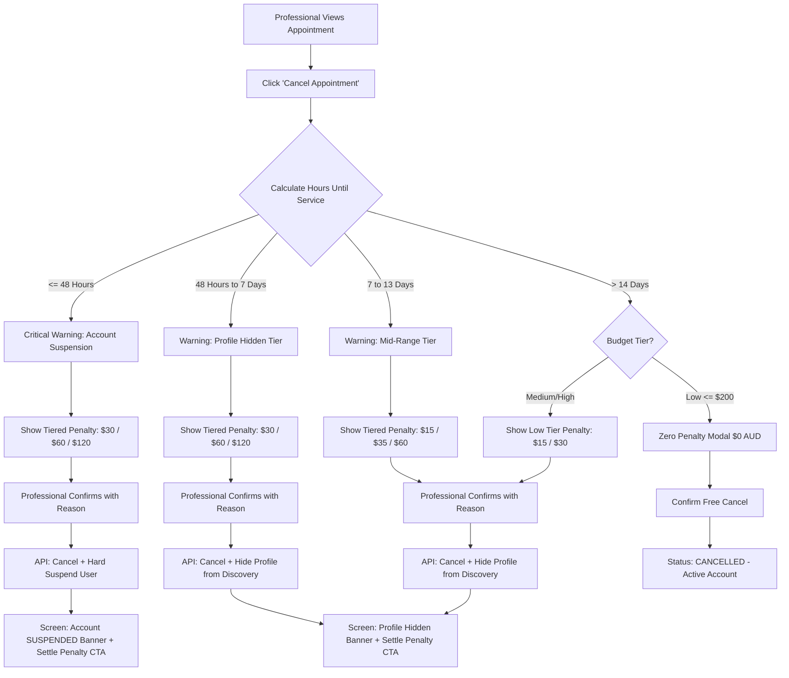

# Low-Fidelity Design: Professional Cancellation Flow

> **Version:** 1.0.0  
> **Target Audience:** Frontend Mobile/Web Engineers, UI/UX Designers, Product Managers  
> **Platform:** Mimilini Web & Mobile App (Professional / Artist Portal)  
> **Key Rules Applied:**
> - Role Separation / Data Privacy: Professional sees only their own penalty, suspension status, and compensation. Customer wallet credit amounts are never shown to the artist.
> - Multi-Tier Policy: Dynamic calculation based on **Budget Tier** (Low ≤$200, Medium $201–$500, High >$500) and **Timeframe Tier** (<48h, 48h–7d, 7–13d, >14d).
> - Last-Minute Protection: Cancelling within 48 hours results in immediate **Hard Account Suspension**.

---

## 🗺️ Professional Cancellation Flowchart



---

## 🖥️ Screen 1: Professional Appointment Management Screen

```text
+--------------------------------------------------------------+
| < Schedule            Appointment #BK-1085                   |
+--------------------------------------------------------------+
| STATUS: [ CONFIRMED ]                  Sat, Nov 22, 2026      |
|                                        02:00 PM - 04:00 PM   |
|                                                              |
| Client Details:                                              |
| [Avatar] Sarah Jenkins                                       |
| 📞 +61 412 345 678 • Verified Customer                      |
| Address: 45 St Kilda Rd, Melbourne VIC 3004 (Home Visit)     |
|                                                              |
| Booked Services:                                             |
| • Bridal Hair Styling                           $180.00 AUD  |
| • Full Glam Makeup                              $120.00 AUD  |
| ------------------------------------------------------------ |
| Total Booking Value:                            $300.00 AUD  |
| Your Expected Payout:                           $240.00 AUD  |
|                                                              |
| [ Message Client ]         [ Open Navigation Maps ]          |
|                                                              |
| ------------------------------------------------------------ |
| Emergency Actions:                                           |
| [ Request Reschedule ]                                       |
| [ Cancel Appointment ]  <-- (Triggers Multi-Tier Modal)       |
+--------------------------------------------------------------+
```

---

## 🖥️ Screen 2A: Critical Warning Modal — Within 48 Hours (<48h)

*Triggered when appointment starts in less than 48 hours.*

```text
+--------------------------------------------------------------+
|            🚨 CRITICAL WARNING: ACCOUNT SUSPENSION           |
+--------------------------------------------------------------+
|                                                              |
|  Appointment Time: In 34 hours (within 48 hours)             |
|  Booking Value: $300.00 AUD (Medium Budget Tier)             |
|                                                              |
|  +--------------------------------------------------------+  |
|  | 🚨 LAST-MINUTE CANCELLATION PENALTY                    |  |
|  | Cancelling on short notice leaves your customer        |  |
|  | without a stylist and severely harms platform trust.   |  |
|  |                                                        |  |
|  | If you proceed with this cancellation:                 |  |
|  | 1. Your account will be IMMEDIATELY SUSPENDED.        |  |
|  | 2. A mandatory penalty fee of $60.00 AUD will be       |  |
|  |    issued to your profile.                             |  |
|  | 3. You cannot receive bookings or login until the     |  |
|  |    penalty is paid in full.                            |  |
|  +--------------------------------------------------------+  |
|                                                              |
|  Reason for emergency cancellation (Required):               |
|  [ Medical emergency / cannot attend                    ]   |
|                                                              |
|  [ Keep Appointment ]                                        |
|  [ I Understand, Confirm Cancellation & Suspend My Account ] |
+--------------------------------------------------------------+
```

---

## 🖥️ Screen 2B: Standard Penalty Modal — 7 to 13 Days / 48h to 7d

*Triggered when cancelling between 48 hours and 14 days in advance.*

```text
+--------------------------------------------------------------+
|             ⚠️ Cancellation Notice: Profile Penalty          |
+--------------------------------------------------------------+
|                                                              |
|  Appointment Time: In 10 days (between 7 and 13 days)        |
|  Booking Value: $150.00 AUD (Low Budget Tier)                |
|                                                              |
|  +--------------------------------------------------------+  |
|  | ⚠️ PROFILE DISCOVERY RESTRICTION                       |  |
|  | A cancellation fee applies to protect customer        |  |
|  | commitments:                                           |  |
|  |                                                        |  |
|  | • Mandatory Penalty Fee: $15.00 AUD                     |  |
|  | • Profile Status: Your profile will be HIDDEN from     |  |
|  |   customer search results until this fee is paid.     |  |
|  | • Existing confirmed bookings remain unaffected.       |  |
|  +--------------------------------------------------------+  |
|                                                              |
|  Reason for cancellation (Required):                         |
|  [ Personal scheduling conflict                         ]   |
|                                                              |
|  [ Keep Appointment ]            [ Confirm Cancellation ]    |
+--------------------------------------------------------------+
```

---

## 🖥️ Screen 2C: Early Cancellation Modal — >14 Days (Zero Penalty Case)

*Triggered when cancelling more than 14 days in advance on a Low Tier booking (≤$200).*

```text
+--------------------------------------------------------------+
|                  Cancel Appointment #BK-1085                 |
+--------------------------------------------------------------+
|                                                              |
|  Appointment Time: In 21 days (more than 14 days in advance) |
|  Booking Value: $120.00 AUD (Low Budget Tier)                |
|                                                              |
|  +--------------------------------------------------------+  |
|  | ✅ ZERO PENALTY ELIGIBLE                               |  |
|  | Because you are cancelling more than 14 days in        |  |
|  | advance for this budget tier, no penalty fee is charged|  |
|  | and your profile visibility is not affected.           |  |
|  +--------------------------------------------------------+  |
|                                                              |
|  Reason for cancellation:                                    |
|  [ Personal travel / holiday                            ]   |
|                                                              |
|  [ Keep Appointment ]            [ Confirm Cancellation ]    |
+--------------------------------------------------------------+
```

---

## 🖥️ Screen 3: Post-Cancellation Professional Home Screen

### Case A: If Suspended (<48 Hours Cancellation)
```text
+--------------------------------------------------------------+
| [!] Mimilini Pro Partner                                    |
+--------------------------------------------------------------+
| 🚨 ACCOUNT SUSPENDED                                         |
| Your account was suspended due to a cancellation within      |
| 48 hours of appointment (#BK-1085).                          |
| Outstanding Penalty: $60.00 AUD                              |
| [ Settle Penalty & Reactivate Account Now ]                  |
+--------------------------------------------------------------+
| (All discovery features and new booking requests are disabled|
| until outstanding penalty is settled)                        |
+--------------------------------------------------------------+
```

### Case B: If Profile Hidden (7–13 Days or 48h–7d Cancellation)
```text
+--------------------------------------------------------------+
| [!] Mimilini Pro Partner                                    |
+--------------------------------------------------------------+
| ⚠️ PROFILE HIDDEN FROM DISCOVERY                             |
| You have an outstanding cancellation penalty of $15.00 AUD.  |
| Your profile is currently hidden from new client searches.   |
| [ Pay $15.00 AUD to Unhide Profile ]                         |
+--------------------------------------------------------------+
| Your schedule & existing bookings are active.                |
+--------------------------------------------------------------+
```

---

## 🖥️ Screen 4: Quick Penalty Settlement Modal

```text
+--------------------------------------------------------------+
|                     Settle Penalty Fee                       |
+--------------------------------------------------------------+
|                                                              |
|  Booking Reference: #BK-1085                                 |
|  Cancellation Timeframe: within 48 hours of appointment      |
|  Penalty Amount Due: $60.00 AUD                              |
|                                                              |
|  Payment Method:                                             |
|  (•) Card ending in 4242 (Visa)                              |
|  ( ) Apple Pay / Google Pay                                  |
|  ( ) Add New Payment Card                                    |
|                                                              |
|  +--------------------------------------------------------+  |
|  | Total Due Today:                           $60.00 AUD  |  |
|  +--------------------------------------------------------+  |
|                                                              |
|  Upon successful payment:                                    |
|  • Your account status will immediately return to ACTIVE.    |
|  • Your profile will be instantly visible in search.         |
|                                                              |
|  [ Pay $60.00 AUD & Reactivate ]                [ Cancel ]   |
+--------------------------------------------------------------+
```

---

## 🔔 Professional Messages & Notifications Reference

| Timeframe | Status Outcome | Text Shown on Alert / Toast / Notification |
|---|---|---|
| **< 48 Hours** | Suspended + Penalty | `"Booking cancelled successfully. Your account has been SUSPENDED due to last-moment cancellation (within 48 hours of appointment). A penalty of $60.00 AUD must be paid to reactivate your account."` |
| **48h to 7 Days** | Profile Hidden + Penalty | `"Booking cancelled successfully. A penalty of $60.00 AUD was issued for cancellation between 48 hours and 7 days of appointment, and your profile is hidden from customer search until paid."` |
| **7 to 13 Days** | Profile Hidden + Penalty | `"Booking cancelled successfully. A penalty of $35.00 AUD was issued for cancellation between 7 and 13 days of appointment, and your profile is hidden from customer search until paid."` |
| **> 14 Days (Low)** | Active (Zero Penalty) | `"Booking cancelled successfully (more than 14 days in advance - zero penalty)."` |
| **> 14 Days (Med/High)**| Profile Hidden + Penalty | `"Booking cancelled successfully. A penalty of $15.00 AUD was issued for cancellation more than 14 days in advance, and your profile is hidden from customer search until paid."` |
| **Customer Cancels (<24h)**| Receives 50% Share | `"Sarah Jenkins has cancelled booking #BK-1085 within 24 hours of appointment. You received 50% compensation payout ($96.00 AUD)."` |
