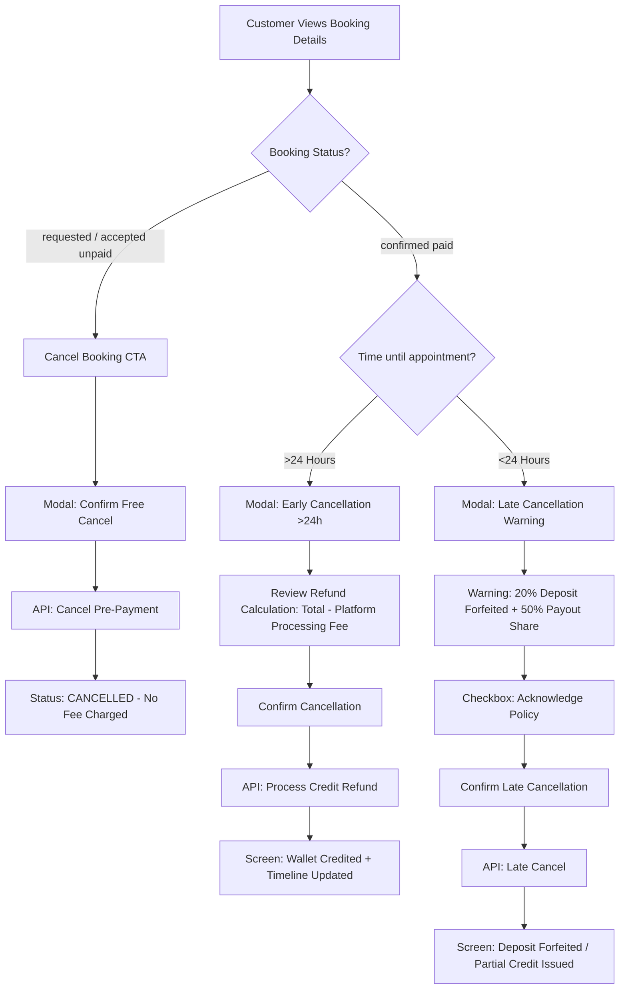

# Low-Fidelity Design: Customer Cancellation Flow

> **Version:** 1.0.0  
> **Target Audience:** Frontend Mobile/Web Engineers, UI/UX Designers, Product Managers  
> **Platform:** Mimilini Web & Mobile App (Customer Portal)  
> **Key Rules Applied:**
> - Role Separation / Data Privacy: Customer sees only their own refund & wallet credit. Professional penalties/suspensions are never shown.
> - Terminology: Uses **"Platform processing fee"** (never "Stripe fee").
> - Explicit timeframes: **>24 Hours in Advance** vs **Within 24 Hours of Appointment (<24h)**.

---

## 🗺️ Customer Cancellation Flowchart



---

## 🖥️ Screen 1: Active Booking Details Screen

```text
+--------------------------------------------------------------+
| < Back             Booking Details #BK-1085                  |
+--------------------------------------------------------------+
| STATUS: [ CONFIRMED ]                  Date: Sat, Nov 22, 2026|
|                                        Time: 02:00 PM (Home)  |
|                                                              |
| Professional:                                                |
| [Avatar] Naz Glamour Makeup                                  |
| ⭐ 4.9 (42 reviews) • Mobile Stylist                         |
|                                                              |
| Services:                                                    |
| • Bridal Hair Styling                           $180.00 AUD  |
| • Full Glam Makeup                              $120.00 AUD  |
| ------------------------------------------------------------ |
| Total Booking Amount:                           $300.00 AUD  |
| Amount Paid (100%):                             $300.00 AUD  |
| (Deposit: $60.00 AUD | Balance: $240.00 AUD)                 |
|                                                              |
| Location:                                                    |
| 45 St Kilda Rd, Melbourne VIC 3004                           |
|                                                              |
| [ Message Professional ]    [ Add to Calendar ]              |
|                                                              |
| ------------------------------------------------------------ |
| [ ! ] Need to make a change?                                 |
| [ Reschedule Appointment ]                                   |
| [ Cancel Booking ]  <-- (Triggers Cancellation Modal)         |
+--------------------------------------------------------------+
```

---

## 🖥️ Screen 2A: Early Cancellation Modal (>24 Hours in Advance)

*Triggered when customer clicks "Cancel Booking" more than 24 hours before the service.*

```text
+--------------------------------------------------------------+
|                     Cancel Booking #BK-1085                  |
+--------------------------------------------------------------+
|                                                              |
|  Timeframe: 3 days remaining (>24 hours in advance)          |
|                                                              |
|  Under our standard cancellation policy, you are eligible    |
|  for a full credit refund to your wallet minus the platform  |
|  processing fee.                                             |
|                                                              |
|  +--------------------------------------------------------+  |
|  | REFUND BREAKDOWN                                       |  |
|  | Total Paid:                                $300.00 AUD |  |
|  | Less Platform Processing Fee:               -$8.00 AUD |  |
|  | ------------------------------------------------------ |  |
|  | Credit Refund to Wallet:                   $292.00 AUD |  |
|  | (Valid for 36 months across any booking)               |  |
|  +--------------------------------------------------------+  |
|                                                              |
|  Reason for cancellation (Optional):                         |
|  [ V Select a reason...                                  ]   |
|  ( ) Change of plans                                         |
|  ( ) Event postponed/cancelled                              |
|  ( ) Booked by mistake                                       |
|  ( ) Other                                                   |
|                                                              |
|  [ Keep Booking ]                 [ Confirm Cancellation ]   |
+--------------------------------------------------------------+
```

---

## 🖥️ Screen 2B: Late Cancellation Modal (Within 24 Hours of Appointment)

*Triggered when customer clicks "Cancel Booking" less than 24 hours before the service.*

```text
+--------------------------------------------------------------+
|               ⚠️ Late Cancellation Policy Alert              |
+--------------------------------------------------------------+
|                                                              |
|  Appointment Time: Today at 02:00 PM                         |
|  Cancellation Window: Within 24 hours of appointment         |
|                                                              |
|  +--------------------------------------------------------+  |
|  | ⚠️ LATE CANCELLATION NOTICE                            |  |
|  | Because this cancellation is within 24 hours:          |  |
|  | • Your 20% deposit ($60.00 AUD) is non-refundable and   |  |
|  |   is forfeited to compensate for the reserved slot.    |  |
|  | • 50% of the professional's net balance payout is paid  |  |
|  |   to the artist as late cancellation compensation.     |  |
|  | • You will receive the remaining $96.00 AUD as Platform |  |
|  |   Credit in your wallet (valid 36 months).             |  |
|  +--------------------------------------------------------+  |
|                                                              |
|  [x] I understand and agree to the Late Cancellation Policy  |
|                                                              |
|  Reason for cancellation (Required):                         |
|  [ Sudden illness or emergency                          ]   |
|                                                              |
|  [ Keep Booking ]            [ Confirm Late Cancellation ]   |
+--------------------------------------------------------------+
```

---

## 🖥️ Screen 3: Post-Cancellation Details & Confirmation Screen

```text
+--------------------------------------------------------------+
| < Back             Booking Details #BK-1085                  |
+--------------------------------------------------------------+
| STATUS: [ CANCELLED ]                                        |
|                                                              |
| +----------------------------------------------------------+ |
| | ✅ Booking Cancelled Successfully                         | |
| | $292.00 Platform Credit has been added to your wallet.   | |
| | Your current wallet balance: $342.00 AUD                 | |
| +----------------------------------------------------------+ |
|                                                              |
| Booking Timeline:                                            |
| • 14 Nov, 10:00 AM — Booking request submitted               |
| • 14 Nov, 10:15 AM — Booking Accepted by Naz                 |
| • 14 Nov, 10:20 AM — 20% Deposit Paid ($60.00 AUD)           |
| • 14 Nov, 05:00 PM — 80% Balance Paid ($240.00 AUD)          |
| • 14 Nov, 05:15 PM — You Cancelled Booking (more than 24     |
|                      hours in advance). $292.00 Platform     |
|                      Credit issued.                          |
|                                                              |
| ------------------------------------------------------------ |
| Looking for another style?                                   |
| [ Explore Other Available Professionals Near You ]           |
+--------------------------------------------------------------+
```

---

## 🔔 Customer Notifications & Alerts Reference

| Scenario | Component | Text Shown to Customer |
|---|---|---|
| **Early Cancel (>24h)** | Screen Toast / Alert | `"Booking cancelled successfully (more than 24 hours in advance). Your 100% payment ($300.00) minus Platform processing fee ($8.00) has been credited to your wallet as $292.00 Platform Credit (valid 36 months)."` |
| **Early Cancel (>24h)** | In-App Notification | `Title: "Booking Cancelled"`<br>`Message: "Your booking #BK-1085 was cancelled. $292.00 Platform Credit was added to your wallet."` |
| **Late Cancel (<24h)** | Screen Toast / Alert | `"Booking cancelled under Late Cancellation policy (within 24 hours of appointment). Platform retained the 20% deposit. You received $96.00 Platform Credit (50% of professional net payout)."` |
| **Late Cancel (<24h)** | In-App Notification | `Title: "Booking Cancelled (Late Cancellation)"`<br>`Message: "Your booking #BK-1085 was cancelled under the late cancellation policy (within 24 hours of appointment)."` |
| **Professional Cancels** | In-App Notification | `Title: "Booking Cancelled by Professional"`<br>`Message: "Naz has cancelled booking #BK-1085. A full refund of $292.00 Platform Credit has been credited to your wallet."` |
